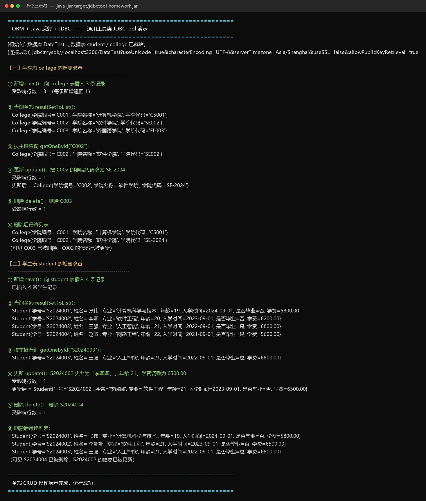
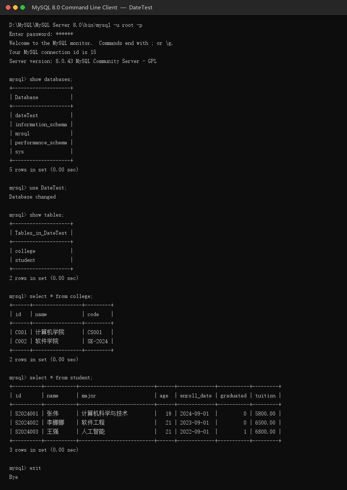

# JDBC + 反射 + ORM 作业答案

> 课程作业：理解 ORM 原理、掌握 Java 反射机制、使用 JDBC 完成数据库增删改查。

---

## 〇、作业要求完成情况对照表

| 序号 | 作业要求 | 完成情况 |
| --- | --- | --- |
| 1 | 理解 ORM 基本原理 | ✅ 见「一、ORM 基本原理」，并用注解 + 反射亲手实现了一个迷你 ORM |
| 2 | 掌握 Java 反射机制在对象创建与属性赋值中的应用 | ✅ `JDBCTool.newInstance()` / `Field.set()` 等，见「二、反射应用」 |
| 3 | 学会使用 JDBC 进行增删改查 | ✅ 全部使用 `PreparedStatement` 完成 |
| 4 | 实现 JDBCTool 工具类（5 个方法 + 辅助方法） | ✅ `util/JDBCTool.java`，见「四、核心代码」 |
| 5 | 定义数据库 DateTest，含学生表、学院表 | ✅ `sql/init.sql`，见「三、数据库设计」 |
| 6 | 通过 JDBCTool 实现两张表的增删改查 | ✅ `app/Main.java`，运行结果见「六、运行效果抓图」 |
| 7 | 项目用 Maven 构建 | ✅ `pom.xml`，`mvn clean package` 构建成功 |
| 8 | 项目用 git 实现版本管理 | ✅ 多次提交，见「七、仓库 URL」 |
| 9 | 运行效果抓图放在答案区 | ✅ 见「六、运行效果抓图」 |
| 10 | 仓库 URL 放在答案区 | ✅ 见「七、仓库 URL」 |

---

## 一、ORM（对象关系映射）基本原理

**ORM（Object Relational Mapping，对象关系映射）** 的核心思想是：
**用「对象」的思维操作「关系表」**，把

- 一张 **表** ↔ 一个 **Java 类**
- 一行 **记录** ↔ 一个 **对象实例**
- 一列 **字段** ↔ 一个 **属性（Field）**

三者自动对应起来。开发者操作的是 `Student` 对象，ORM 框架在底层把它翻译成 SQL。

### ORM 的工作流程（本项目实现思路）

```
        实体类 Student                    数据库表 student
   ┌──────────────────────┐           ┌────────────────────────┐
   │ @Table("student")    │  表名映射  │ CREATE TABLE student   │
   │ @Column("id")  id    │ ◄───────► │ id        VARCHAR  PK  │
   │ @Column("name") name │ ◄───────► │ name      VARCHAR      │
   │ @Column("major")...  │ ◄───────► │ major     VARCHAR      │
   │ @Column("enroll_date")│ ◄──────► │ enroll_date DATE       │
   └──────────────────────┘           └────────────────────────┘
                 │                                     ▲
                 │  ① 反射读注解，得到「类↔表」「属性↔列」映射
                 │  ② 反射创建对象、反射读写属性
                 ▼                                     │
          JDBCTool 工具类  ──── ③ 动态拼 SQL + PreparedStatement ────► MySQL
```

要实现通用 ORM，必须解决 4 个问题：

1. **映射关系从哪来？** —— 用自定义注解 `@Table`、`@Column` 在实体类上声明；
2. **对象怎么创建？** —— 反射 `clazz.getDeclaredConstructor().newInstance()`；
3. **属性怎么赋值/取值？** —— 反射 `Field.set(obj, value)` / `Field.get(obj)`；
4. **SQL 怎么生成？** —— 根据反射得到的表名、列名动态拼接，值用 `?` 占位符绑定。

---

## 二、Java 反射机制在对象创建与属性赋值中的应用

本项目所有「通用能力」都建立在反射之上，关键代码如下：

### 1. 反射创建对象（不知道具体类，也能 new 出来）

```java
// JDBCTool.newInstance()
Constructor<T> constructor = clazz.getDeclaredConstructor(); // 拿到无参构造器
constructor.setAccessible(true);
return constructor.newInstance();                            // 创建实例
```

`resultSetToList()` 在运行期只知道一个 `Class<T>`，正是靠这一行把每一行记录变成对象的。

### 2. 反射读取注解（解析映射关系）

```java
// 取类上的 @Table 注解 → 表名
Table table = clazz.getAnnotation(Table.class);
String tableName = table.value();

// 取属性上的 @Column 注解 → 列名、是否主键
Column column = field.getAnnotation(Column.class);
```

### 3. 反射为私有属性赋值（绕过 private 限制）

```java
field.setAccessible(true);                                   // 突破 private 访问限制
field.set(obj, convertValue(columnValue, field.getType()));  // 赋值
Object value = field.get(obj);                               // 读值（save/update 时用）
```

### 4. 反射遍历属性，动态拼 SQL

```java
for (Field field : getAllFields(clazz)) {        // 反射拿到所有属性（含父类）
    String columnName = resolveColumnName(field); // 属性名 → 列名
    Object value = readFieldValue(field, obj);    // 反射读取属性值
    ...
}
```

### 5. 列名 → 属性 的反查

查询时方向相反：从 `ResultSetMetaData` 拿到列名，再反查实体属性：

```java
ResultSetMetaData metaData = rs.getMetaData();
String columnLabel = metaData.getColumnLabel(i);      // 列名
Field field = findFieldByColumnName(clazz, columnLabel); // 反查属性
```

---

## 三、数据库设计（DateTest）

```sql
CREATE DATABASE IF NOT EXISTS DateTest
    DEFAULT CHARACTER SET utf8mb4 COLLATE utf8mb4_general_ci;

USE DateTest;

-- 学院表：id、name、code
CREATE TABLE college (
    id   VARCHAR(32) NOT NULL COMMENT '学院编号',
    name VARCHAR(64)          COMMENT '学院名称',
    code VARCHAR(32)          COMMENT '学院代码',
    PRIMARY KEY (id)
) ENGINE=InnoDB DEFAULT CHARSET=utf8mb4 COMMENT='学院表';

-- 学生表：id、name、major、age、入学时间、是否毕业、学费
CREATE TABLE student (
    id          VARCHAR(32)   NOT NULL COMMENT '学号',
    name        VARCHAR(64)            COMMENT '姓名',
    major       VARCHAR(64)            COMMENT '专业',
    age         INT                    COMMENT '年龄',
    enroll_date DATE                   COMMENT '入学时间',
    graduated   TINYINT(1)             COMMENT '是否毕业 0否1是',
    tuition     DECIMAL(10,2)          COMMENT '学费',
    PRIMARY KEY (id)
) ENGINE=InnoDB DEFAULT CHARSET=utf8mb4 COMMENT='学生表';
```

### 实体类与表的对应关系

| Student 属性 | Java 类型 | student 列 | MySQL 类型 |
| --- | --- | --- | --- |
| id | String | id | VARCHAR(32) PK |
| name | String | name | VARCHAR(64) |
| major | String | major | VARCHAR(64) |
| age | Integer | age | INT |
| enrollDate | LocalDate | enroll_date | DATE |
| graduated | Boolean | graduated | TINYINT(1) |
| tuition | BigDecimal | tuition | DECIMAL(10,2) |

| College 属性 | Java 类型 | college 列 |
| --- | --- | --- |
| id | String | id |
| name | String | name |
| code | String | code |

> 说明：题目中的「入学时间」「是否毕业」「学费」分别对应 `enroll_date`、`graduated`、`tuition` 三列。

---

## 四、JDBCTool 工具类核心代码

### 方法1：`resultSetToList` —— ResultSet → 对象列表

```java
public static <T> List<T> resultSetToList(ResultSet rs, Class<T> clazz) throws Exception {
    List<T> list = new ArrayList<>();
    if (rs == null) {
        return list;
    }
    ResultSetMetaData metaData = rs.getMetaData();
    int columnCount = metaData.getColumnCount();

    while (rs.next()) {                                 // 逐行遍历
        T obj = newInstance(clazz);                     // 反射创建对象
        for (int i = 1; i <= columnCount; i++) {        // 逐列赋值
            String columnLabel = metaData.getColumnLabel(i);
            Object columnValue = rs.getObject(i);
            if (columnValue == null) continue;

            Field field = findFieldByColumnName(clazz, columnLabel);
            if (field == null) continue;

            field.setAccessible(true);
            field.set(obj, convertValue(columnValue, field.getType())); // 反射赋值
        }
        list.add(obj);
    }
    return list;
}
```

### 方法2：`save` —— 新增

```java
public static <T> int save(T obj, Connection connection) throws Exception {
    Class<?> clazz = obj.getClass();
    String tableName = getTableName(clazz);          // 反射：@Table → 表名
    Map<Field, String> columns = getColumnMappings(clazz); // 反射：属性 → 列名

    StringBuilder columnSql = new StringBuilder();
    StringBuilder placeholderSql = new StringBuilder();
    List<Object> values = new ArrayList<>();

    for (Map.Entry<Field, String> entry : columns.entrySet()) {
        columnSql.append(entry.getValue()).append(", ");
        placeholderSql.append("?, ");
        values.add(readFieldValue(entry.getKey(), obj)); // 反射读取属性值
    }
    trimTail(columnSql);
    trimTail(placeholderSql);

    String sql = "INSERT INTO " + tableName + " (" + columnSql + ") VALUES (" + placeholderSql + ")";
    return executeUpdate(connection, sql, values);       // 统一交给 PreparedStatement 执行
}
```

实际生成的 SQL：

```sql
INSERT INTO student (id, name, major, age, enroll_date, graduated, tuition)
VALUES (?, ?, ?, ?, ?, ?, ?)
```

### 方法3：`update` —— 按主键更新

```java
public static <T> int update(T obj, Connection connection) throws Exception {
    Class<?> clazz = obj.getClass();
    String tableName = getTableName(clazz);
    Field idField = getPrimaryKeyField(clazz);        // 反射：@Column(id=true) → 主键
    if (idField == null) {
        throw new IllegalStateException("实体类 " + clazz.getName() + " 未声明主键");
    }

    Map<Field, String> columns = getColumnMappings(clazz);
    StringBuilder setSql = new StringBuilder();
    List<Object> values = new ArrayList<>();

    for (Map.Entry<Field, String> entry : columns.entrySet()) {
        if (entry.getKey().equals(idField)) continue; // 主键不参与 SET
        setSql.append(entry.getValue()).append(" = ?, ");
        values.add(readFieldValue(entry.getKey(), obj));
    }
    trimTail(setSql);

    String sql = "UPDATE " + tableName + " SET " + setSql
            + " WHERE " + resolveColumnName(idField) + " = ?";
    values.add(readFieldValue(idField, obj));         // WHERE 条件的值放在最后
    return executeUpdate(connection, sql, values);
}
```

实际生成的 SQL：

```sql
UPDATE student SET name=?, major=?, age=?, enroll_date=?, graduated=?, tuition=?
WHERE id=?
```

### 方法4：`delete` —— 按主键删除

```java
public static <T> int delete(T obj, Connection connection) throws Exception {
    Class<?> clazz = obj.getClass();
    String tableName = getTableName(clazz);
    Field idField = getPrimaryKeyField(clazz);
    if (idField == null) {
        throw new IllegalStateException("实体类 " + clazz.getName() + " 未声明主键");
    }
    String sql = "DELETE FROM " + tableName + " WHERE " + resolveColumnName(idField) + " = ?";
    List<Object> values = new ArrayList<>();
    values.add(readFieldValue(idField, obj));
    return executeUpdate(connection, sql, values);
}
```

实际生成的 SQL：

```sql
DELETE FROM student WHERE id = ?
```

### 方法5：`getOneById` —— 按主键查询单条

```java
public static <T> T getOneById(String id, Class<T> clazz, Connection connection) throws Exception {
    String tableName = getTableName(clazz);
    Field idField = getPrimaryKeyField(clazz);
    if (idField == null) {
        throw new IllegalStateException("实体类 " + clazz.getName() + " 未声明主键");
    }
    String sql = "SELECT * FROM " + tableName + " WHERE " + resolveColumnName(idField) + " = ?";

    try (PreparedStatement ps = connection.prepareStatement(sql)) {
        ps.setObject(1, id);
        try (ResultSet rs = ps.executeQuery()) {
            List<T> list = resultSetToList(rs, clazz);  // 复用方法1
            return list.isEmpty() ? null : list.get(0);
        }
    }
}
```

### 辅助方法（实现五种访问的统一底座）

| 辅助方法 | 作用 |
| --- | --- |
| `executeUpdate(Connection, String, List<Object>)` | **统一执行入口**：创建 `PreparedStatement`、循环 `setObject` 绑定参数、执行并返回受影响行数，自动关闭 Statement |
| `getTableName(Class)` | 反射读 `@Table` 得到表名，未标注则退化为类名小写 |
| `resolveColumnName(Field)` | 反射读 `@Column` 得到列名，未标注则退化为属性名 |
| `getColumnMappings(Class)` | 返回「属性 → 列名」的有序映射，保证与 `?` 占位符顺序一致 |
| `getPrimaryKeyField(Class)` | 反射找到主键属性（`@Column(id=true)`，兜底找名为 `id` 的属性） |
| `getAllFields(Class)` | 取得所有非静态、非瞬态属性（含父类），支持实体继承 |
| `findFieldByColumnName(Class, String)` | 列名 → 属性 的反查 |
| `readFieldValue(Field, Object)` | 反射读取属性值（自动 `setAccessible`） |
| `newInstance(Class)` | 反射创建实例 |
| `convertValue(Object, Class)` | JDBC 类型 → Java 类型（DATE→LocalDate、TINYINT→Boolean、DECIMAL→BigDecimal 等） |
| `toSqlParameter(Object)` | Java 类型 → JDBC 类型（LocalDate→java.sql.Date 等） |
| `close(AutoCloseable...)` | 统一、容错地关闭 JDBC 资源 |

> 防 SQL 注入：所有值都不做字符串拼接，一律通过 `ps.setObject(i + 1, value)` 绑定。

---

## 五、JDBC 增删改查的关键点

1. **加载驱动 / 建立连接**：`DriverManager.getConnection(url, user, password)`，配置集中在 `db.properties`；
2. **用 `PreparedStatement` 而不是 `Statement` 拼值**：预编译 + 参数绑定，既安全又高效；
3. **`executeUpdate()` 返回受影响行数**：用于判断 save/update/delete 是否成功；
4. **`executeQuery()` 返回 `ResultSet`**：配合方法1转换成对象列表；
5. **资源关闭**：`Connection` 由调用方用 try-with-resources 管理，`Statement`/`ResultSet` 在工具类内部自动关闭。

---

## 六、运行效果抓图（答案区）

### 1. 程序运行效果（`java -jar target/jdbctool-homework.jar`）



图中依次演示了：

- **学院表 college**：① 新增 3 条 → ② 查询全部 → ③ 按主键查询 C002 → ④ 更新 C002 的学院代码 → ⑤ 删除 C003 → ⑥ 复查确认
- **学生表 student**：① 新增 4 条 → ② 查询全部 → ③ 按主键查询 S2024003 → ④ 更新 S2024002 → ⑤ 删除 S2024004 → ⑥ 复查确认

可以看到每个方法都正确返回了受影响行数（新增/更新/删除均为 1），查询结果能正确映射出
`入学时间=2024-09-01`、`是否毕业=是/否`、`学费=5800.00` 等字段，说明反射的类型转换工作正常。

### 2. 数据库实际数据校验（MySQL 命令行）



数据库中的最终数据与程序输出完全一致：college 剩 2 条（C002 的 code 已更新为 `SE-2024`），
student 剩 3 条（S2024004 已删除，S2024002 已更新）。

---

## 七、仓库 URL（答案区）

- **仓库地址**：<https://github.com/jiangqi1009/jdbctool-homework>
- **克隆命令**：

  ```bash
  git clone https://github.com/jiangqi1009/jdbctool-homework.git
  ```

- **在线浏览**：浏览器打开上面的地址即可查看全部源码、README 与运行效果截图。

---

## 八、Git 版本管理

项目使用 Git 进行版本管理，按「项目骨架 → 映射注解与实体类 → JDBCTool 工具类 → 演示程序 → 文档」
的功能模块分阶段提交，提交信息遵循 `chore / feat / docs` 前缀约定。

查看完整提交历史：

```bash
git log --oneline
```

项目主体提交（由旧到新）：

```
eff6274 chore: 初始化 Maven 项目骨架（pom.xml、.gitignore）
75143d6 feat: 新增 Table/Column 映射注解与 Student、College 实体类
bac7ada feat: 实现 JDBCTool 通用工具类与数据库连接工具
d7278b0 feat: 完成两张表的增删改查演示程序与建库建表脚本
565c401 docs: 添加 README、运行效果截图与作业答案文档
7b49512 docs: 答案文档写入仓库 URL 与提交记录
```

> 说明：文档的后续修订会以新的 `docs` 提交继续追加，完整、最新的历史以仓库中
> `git log --oneline` 的输出为准。

---

## 九、如何运行本项目

```bash
# 1. 修改数据库账号密码
vim src/main/resources/db.properties

# 2. Maven 构建（会自动生成可执行 fat jar）
mvn clean package

# 3. 运行（程序会自动创建 DateTest 库和两张表）
java -jar target/jdbctool-homework.jar
```

> 环境要求：JDK 17+、Maven 3.6+、MySQL 8.0。
